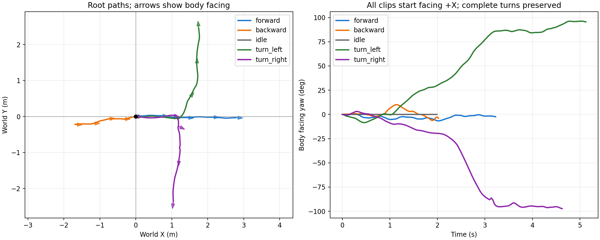
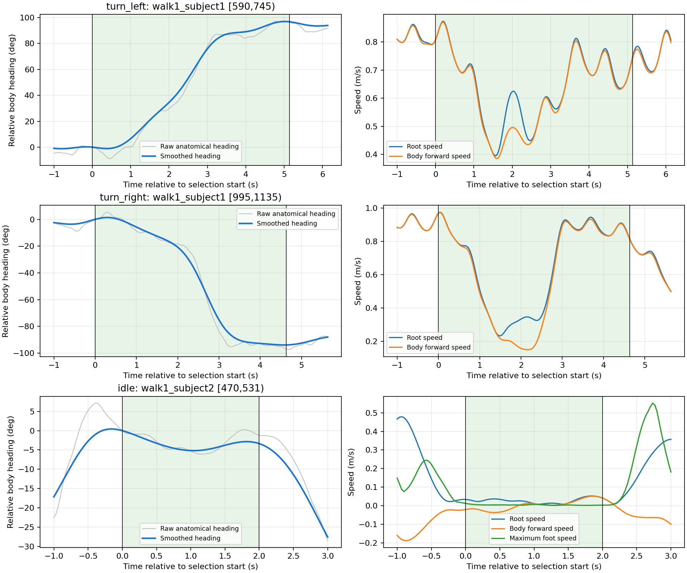

# 五类动作与初始 +X 朝向检查

当前 `skeleton17_collision` 的独立五类结果位于 [five_behaviors_x](../../data/outputs/skeleton17_collision/five_behaviors_x/)，使用同一 MJCF、120 Hz、原速和官方六字段结构。选段固定在 [清单](../../data/selections/lafan1_five_behaviors.json)，复现、回放和验证命令见 [工作流](../../docs/five_behaviors.md)。

| 行为 | 来源源帧区间 `[start,stop)` | 输出帧数 | 采样跨度 | 输出根 yaw 变化 |
| --- | --- | ---: | ---: | ---: |
| 前进 | walk2_subject4 `[2763,2861)` | 388 | 3.225 s | −2.43° |
| 后退 | walk3_subject4 `[1866,1928)` | 244 | 2.025 s | −3.93° |
| 中立直立静站 | 当前 MJCF 零位 | 240 | 1.992 s | 0° |
| 完整左转 | walk1_subject1 `[590,745)` | 616 | 5.125 s | +95.53° |
| 完整右转 | walk1_subject1 `[995,1135)` | 556 | 4.625 s | −97.27° |

每段采用一次固定世界 Z 轴旋转与 XY 平移，使首帧根局部 +X 面朝世界 +X、起点 XY 为零。前进净位移约 `(+2.779,−0.031)` m，后退约 `(−1.689,−0.218)` m；两条的关节角、局部 body 坐标、帧率、body 列表与原结果逐元素一致，相对 yaw 保持不变。

转弯是走动中的完整约 90° 转向，包含接近、转向和稳定退出。此前扫描报告的 `walk2_subject4 [2335,2440)`、`walk3_subject4 [3845,3935)` 是局部候选，后续仍有转向，不能当成完整事件。本次换用 `walk1_subject1`，没有修改此前扫描报告或旧数据。源窗口前后额外一秒的对比与数值见 [源检查 JSON](source_window_review.json)：

图中底部站立窗口是早期自然站立 mocap 候选，不是最终静站。最终静站从目标 MJCF 零位直接构造：21 个标量关节角全为零、根姿态直立、根位置固定，根高约 1.01881 m。左右脚碰撞盒中心具有相同 X/Z 坐标，中心间距约 0.2309 m；两脚底面在虚拟地面上方 1 mm。该姿势通过运动学/几何检查，不代表重力下的物理平衡。较早试做的 mocap 站立文件 `idle_walk1_subject2/` 保留；候选源窗口目标模型比较见 [站立候选比较](standing_selection_comparison.json)。

五条分别通过字段/时间/四元数、来源哈希、模型一致性、关节限位与膝硬锁、局部与世界 FK、地面穿透及采样跨腿间距检查。构建命令另检查初始 +X/XY 零点、前后退方向、转弯符号、已有前后退数据不变量和站立几何阈值。各条完整诊断见输出目录的 `_validation.json`；PNG 和 MP4 位于其 `preview/`。

行走和转弯仍有约 0.18–0.60 m/s 的近地脚角点平均速度诊断，以及超过 5 cm 的公共根 Z 调整。固定朝向旋转不会消除这些既有适配误差。通过运动学检查不代表动力学稳定；转弯也不能直接首尾跳接成周期。

本次 32 项自用测试通过。历史模型、配置及结果共 336 个文件逐个核对，全部保留，详见 [preservation.json](preservation.json)。官方已跟踪 GMR 文件无改动。
