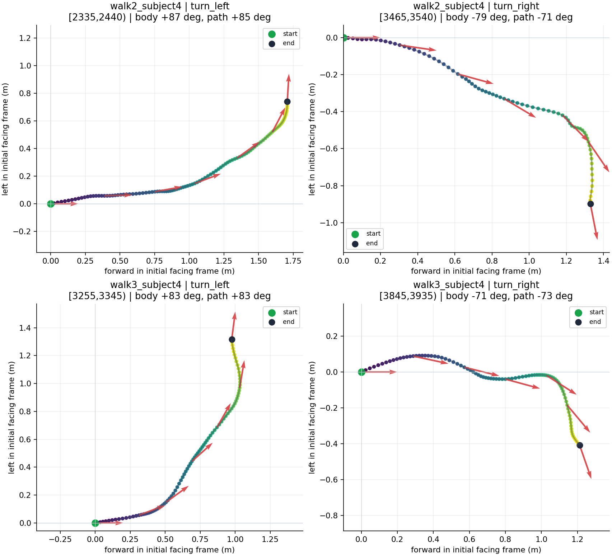
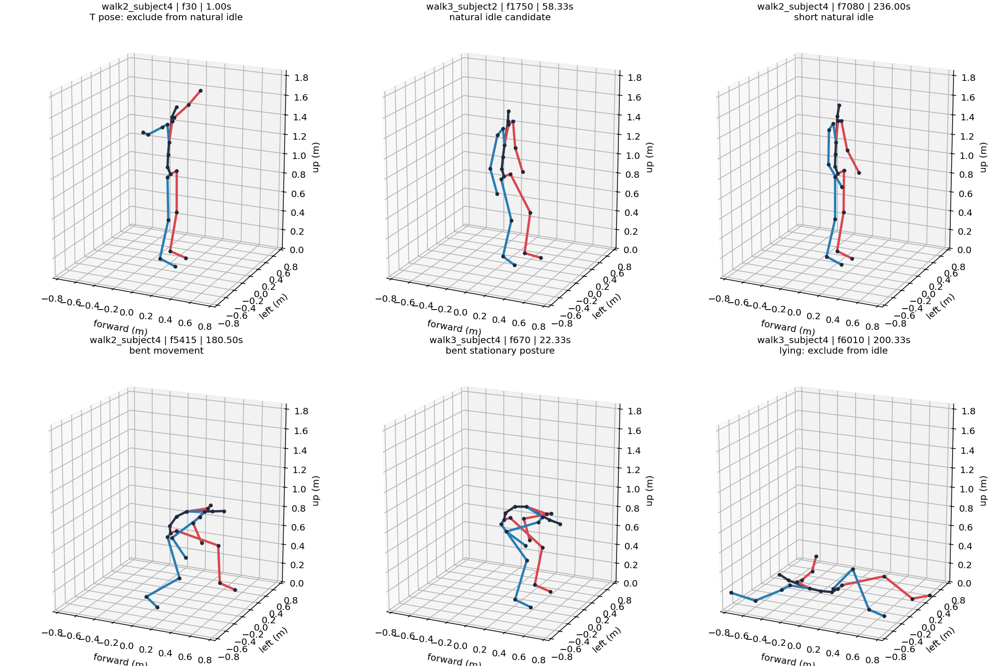
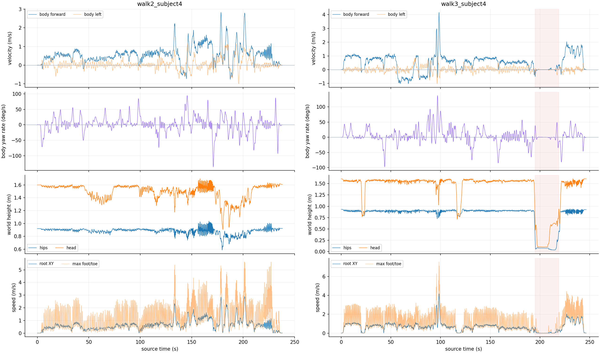

# LAFAN1 walk 行为与静止片段检查

检查日期：2026-11-15。检查本地全部 **12 条 `walk*.bvh` 完整源录制**，使用官方 BVH 读取和 FK 变换到 GMR 的米制、世界 Z-up 坐标；两条 subject4 额外检查根轨迹、身体朝向、手臂/躯干/腿姿态。这里只新增分析报告，未重定向或更改正式数据、选段、模型与官方代码。

## 结论和建议的五类参考

**LAFAN1 walk 数据内已有前进、后退、左转、右转和自然站立的来源，不必为了这五类另下数据集。** 全部12条均检出左右转候选；下面四个subject4转弯窗口经过身体朝向与路径共同核验。自然站立要单独筛，不能用“根速度接近零”直接判断。

| 类别 | BVH | 原始帧 `[start,stop)` | 时间区间约 / s | 首末采样跨度 / s | 本体前向速度 / m/s | 身体转角 |
| --- | --- | --- | --- | --- | --- | --- |
| idle | `walk3_subject2` | `[1724,1804)` | 57.47–60.13 | 2.633 | -0.020 | +0.3° |
| forward | `walk2_subject4` | `[2763,2861)` | 92.10–95.37 | 3.233 | +0.738 | -2.5° |
| backward | `walk3_subject4` | `[1866,1928)` | 62.20–64.27 | 2.033 | -0.714 | -1.2° |
| turn_left | `walk2_subject4` | `[2335,2440)` | 77.83–81.33 | 3.467 | +0.566 | +86.6° |
| turn_right | `walk3_subject4` | `[3845,3935)` | 128.17–131.17 | 2.967 | +0.484 | -70.9° |

`idle` 推荐窗口约2.63秒，包含真实重心微动，不是冻结的单帧；脚速 P95 为 0.048 m/s。已有前进/后退窗口沿用正式选段。左/右转是边走边改变身体与路径朝向，分别约 +87° / −71°；路径也相应约 +85° / −73°，不是只转上身或沿世界 −Y 走。上述转弯窗口尚未按同足步态事件裁成严格1–2周期，是后续选段/重定向候选。

所有原始帧均为 **0基、右端不包含**，对应 `--start_frame=start`、`--max_frames=stop-start`。时间列采用 `[start/fps,stop/fps)`；“首末采样跨度”为 `(stop-start-1)/fps`，因此比边界时间差少一个源采样间隔。BVH 的实际帧率约 `30.000300003 Hz`，不是已经导出的120 Hz；**不能把原始帧号直接用到120 Hz NPZ上**。详细未四舍五入数值、哈希和阈值见 [audit.json](audit.json)。

## 两条重点长录制有什么

### walk2_subject4

全长7146帧，首末跨度约238.164秒；包含直行、曲线转弯/掉头、起步/停步、原地转向和末尾短站立，并非一段单一的匀速前进。

- 左转：`[2335,2440)`；右转备选：`[3465,3540)`。均保持正的本体前向速度；后者平均躯干前倾约28.8°，因此本轮更推荐另一条录制中直立的右转窗口。
- 约179.5–197.6秒间歇出现明显躯干前倾、屈膝的移动；例如180.5秒躯干接近水平，不应当作普通直立行走参考。
- 约228–235秒低根位移包含转身、踏步/抬脚及站稳过渡；脚仍可快速运动，不能整体标为idle。
- 自然站立的保守核心是 `[7065,7100)`，约235.50–236.66秒（首末采样约1.13秒）。根平均水平速度约0.041m/s，脚速P95约0.013m/s，双臂自然下垂。放宽到 `[7065,7108)` 可到约1.4秒，但手臂已临近抬起过渡；不要为了凑2秒把邻近踏步或举手并入。
- 开头约0–3.3秒和结束举手后的片段主要是T/A标定姿态。虽然极静止，不能与自然站立混为一类。

### walk3_subject4

全长7399帧，首末跨度约246.598秒；除前进、后退和左右转外，还包含弯腰/屈膝、地面躺倒、坐起/起身。

- 当前正式 `[1866,1928)` 是**后退**。更长的 `[1800,2100)`（约60–70秒）也主要为后退，本体前向速度约−0.716m/s；长段存在朝向轻微摆动，后续仍需裁周期。
- 左转备选 `[3255,3345)`；右转推荐 `[3845,3935)`，躯干平均倾角仅约2.6°，详见表格。
- 约20.5–24.0秒、116.1–121.1秒含深弯腰，内部有双脚不动的停留，躯干约接近水平；这不是站直idle。
- 约195–218.7秒是低姿态地面动作，随后起身。约200秒时髋高度约0.08m、头高度约0.10m；其中近10秒根速度极低的躺地绝不能被当作静站。
- 开头约0–1.9秒和结束约245–246.6秒主要为T/A标定姿态。本轮未找到至少1秒、双臂自然垂下且直立的干净站立窗口。

## 转弯、站立备选

| 类别 | BVH | 原始帧 `[start,stop)` | 时间区间约 / s | 首末采样跨度 / s | 本体前向速度 / m/s | 身体转角 |
| --- | --- | --- | --- | --- | --- | --- |
| turn_left | `walk3_subject4` | `[3255,3345)` | 108.50–111.50 | 2.967 | +0.613 | +82.7° |
| turn_right | `walk2_subject4` | `[3465,3540)` | 115.50–118.00 | 2.467 | +0.701 | -78.9° |
| idle | `walk2_subject4` | `[7065,7100)` | 235.50–236.66 | 1.133 | +0.035 | -1.1° |
| idle | `walk1_subject2` | `[470,531)` | 15.67–17.70 | 2.000 | +0.003 | -3.4° |
| idle | `walk2_subject3` | `[898,956)` | 29.93–31.87 | 1.900 | -0.004 | -3.2° |
| backward | `walk3_subject4` | `[1800,2100)` | 60.00–70.00 | 9.967 | -0.716 | +5.2° |

`walk1_subject2` 站立备选约2秒，双脚基本固定、躯干较直，手臂姿态稍不对称；`walk2_subject3` 约1.9秒也很稳定，但手臂有轻微活动。对于当前17活动坐标模型，上肢并非全部可动；仍优先选与目标模型自然站姿接近的片段，避免把下蹲或地面静止混入idle。

## 现有NPZ与完整BVH的区别

当前GMR正式目录及Isaac训练任务 `motions/` 的两份文件仍是短动作：

| 文件 | 帧数 / Hz | 首末跨度 | 源区间 | 行为 |
| --- | --- | --- | --- | --- |
| `walk2_subject4_120hz.npz` | 388 / 120 | 3.225s | `[2763,2861)` | 前进 |
| `walk3_subject4_120hz.npz` | 244 / 120 | 2.025s | `[1866,1928)` | 后退 |

**新找到的左右转和静站位于完整BVH中，尚不在这两份短NPZ里。** 文件名是录制名，不能用 `walk2/3` 的编号推断行为类别。

## 判别方法、限制与后续操作

1. 根水平速度在人体本体前向上的投影，决定前进/后退。人体前向由左右髋与世界竖直的叉乘确定，在推荐的直立窗口中与原BVH Hips局部+Y经旋转后的水平投影相符（平均偏差小于0.48°），躺地或任意倾斜姿态下不应当作普遍等价关系。不能用世界X/Y速度符号判断前进/后退。
2. 左转是世界Z-up平面yaw增加，右转是减少；同时要求身体朝向和移动路径的切线朝向同向变化，并在窗口内保持行走。只看根四元数可能把扭身、原地转身或侧向移动误当作弧线转弯。
3. 静站联合检查根速度、双脚/脚尖速度、低位足、髋/头高度、躯干倾角、膝屈曲和手臂姿态，排除原地踏步、Tpose、弯腰、躺地。检测存在阈值，边界附近可有自然摇摆；脚速来自平滑后的FK骨骼关节点，不是实测接触点或地面力。
4. 已对重点姿态及转弯轨迹做可视核对。尚未为这些新窗口求目标骨架IK，不能据此保证重定向后无脚滑、满足碰撞/限位或适合循环。

现有 `retarget` / `validate` / `play` / `preview` 可继续用，不需要为每个行为各写一套IK。**现有 `select` 是直线行走周期筛选器**，限制速度和朝向变化，会主动过滤静站和明显转弯，不能直接用于这五类的统一自动选段。后续应保存独立的行为候选清单，再逐类裁窗、使用对应BVH的配置，并写入各自输出目录；17单条脚本不允许同一目录重复同名源参考，现有批处理也拒绝重复BVH stem，不能直接把同一录制的forward/left/right三个窗口当三条同名clip塞进旧批次。

建议先补idle、左转、右转，保留已有前进/后退，构成五类最小参考库；idle不需要按步态周期裁。速度可由任务奖励在合理范围调整，但参考运动分布仍约束动作风格，过大的速度/角速度差异可能与AMP奖励冲突。约90°转弯不是原地旋转，也不是左/右横移；若训练目标是 `v_x>0,w_z≠0`，本次候选合适，若目标是 `v_x≈0,w_z≠0`，需另外筛原地转身。

短片段并不自动满足无缝循环。静站要检查首尾姿态/速度，转弯要检查局部姿态相位和累计SE(2)根位姿；不能简单把世界轨迹首尾接起来。当前阶段只完成来源确认和候选推荐，未自动扩展、冻结、镜像或重新导出数据。

## 可视证据

转弯图将路径变换到各片段初始人体朝向坐标，仅用于显示：横轴初始前方，纵轴初始左方，红箭头为身体朝向，路径颜色表示时间。这不会改写原数据朝向。

## 全部walk的存在性扫描

下表的“有”表示数值规则检出候选，数量并非转弯事件总数。除重点窗口外未逐段人工审阅。没有检出严格自然idle不代表文件中绝无更宽松或更短的站立。

| BVH | 左转候选 | 右转候选 | 严格自然idle >=1s |
| --- | --- | --- | --- |
| `walk1_subject1` | 有 | 有 | 未检出 |
| `walk1_subject2` | 有 | 有 | [463,532)；[591,623) |
| `walk1_subject5` | 有 | 有 | 未检出 |
| `walk2_subject1` | 有 | 有 | 未检出 |
| `walk2_subject3` | 有 | 有 | [898,956) |
| `walk2_subject4` | 有 | 有 | [7065,7108) |
| `walk3_subject1` | 有 | 有 | 未检出 |
| `walk3_subject2` | 有 | 有 | [1711,1804) |
| `walk3_subject3` | 有 | 有 | 未检出 |
| `walk3_subject4` | 有 | 有 | 未检出 |
| `walk3_subject5` | 有 | 有 | 未检出 |
| `walk4_subject1` | 有 | 有 | 未检出 |

其他正式选段也不是统一的纯直行标签：例如 `walk1_subject5` 的既有源窗口有约+79°身体朝向变化，`walk3_subject5` 的窗口含明显转向及侧向速度。多motion训练应按实际行为标注，不应简单把所有 `walk*.npz` 都视为forward。细节见JSON各文件的 `existing_formal_selection`。
